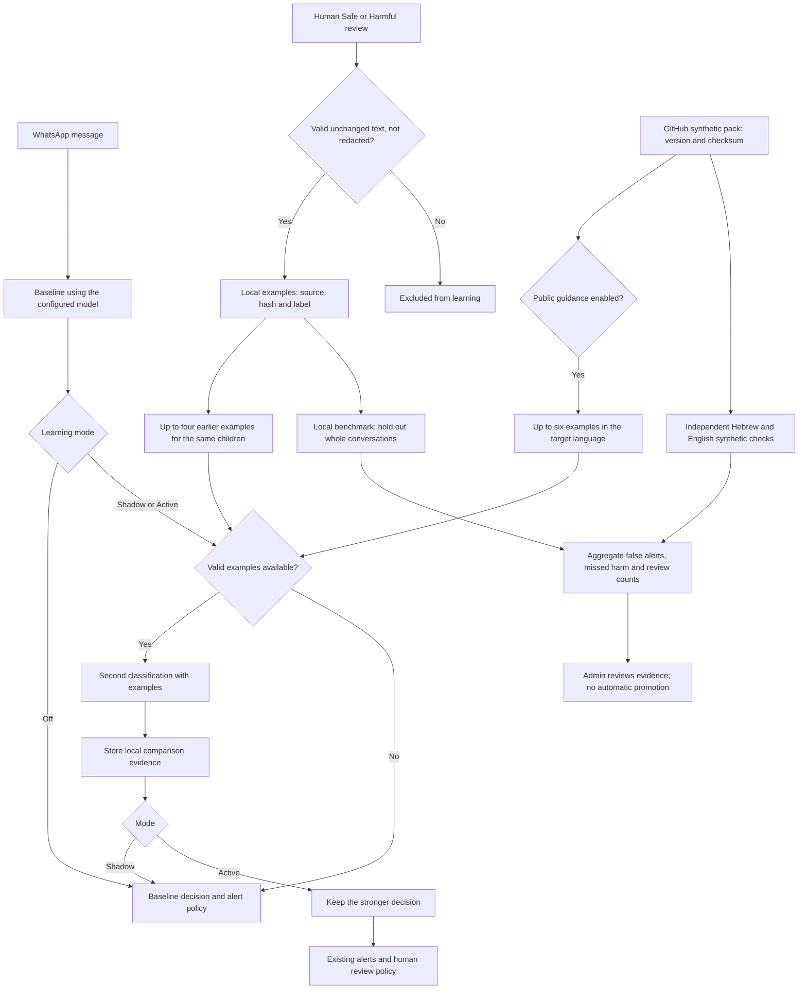
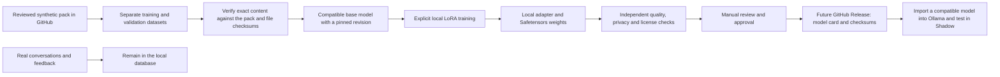

# Iris learning flow and logic

## Reducing avoidable review work

Document text analysis uses the configured classifier with bounded local extraction
for PDF, DOCX, XLSX, PPTX, ODT/ODS/ODP and common text attachments. Byte signatures
also route images, audio and video reported as generic attachments to media analysis.
See the [attachment coverage matrix](README.md) for limits and unsupported formats.
Unreadable, embedded, dynamic or unrendered visual content prevents automatic
clearance; readable text may still produce a harmful verdict. Extracted text is
temporary; only format and completeness metadata accompany classification scores.
This is an AI classification path, not a source of human learning labels, and does
not update model weights or change learning mode.

Local Ollama vision checks up to twelve chronological frames across clips of at
most 60 seconds, including the beginning and end. Requests contain at most six
frames each, with the caption and available speech transcript repeated in each
request. Every batch must succeed, and the highest score for each category wins;
safe frames cannot dilute harmful evidence. Silent clips can be classified from
visual evidence; an unreadable frame, failed speech check, unknown duration or
longer clip cannot be automatically cleared by this path. Sampling is not an
exhaustive frame-by-frame inspection. Classification traces record duration,
sample timestamps and audio-check status, and the UI labels the sampled check.
Video verdicts remain AI decisions, never human training labels.

The evaluation gate also recognizes a statistically supported reduction in
reviews of human-labelled safe messages as an improvement. Existing minimum
sample sizes, language checks, precision/recall and non-regression requirements
still apply; reduced workload never compensates for missed harm. The policy
revision invalidates earlier reports, and promotion remains explicit.

Classification requires readable evidence. Odd-sized animated WebP stickers are
converted in RGB before padding, preserving their canvas and frame offsets so
the configured local vision model can inspect them instead of receiving a decode
failure. The existing first-frame analysis limit still applies to animations.

Confirmed unavailable-media and empty unknown-message failures go to the separate
**Unavailable content** recovery view automatically. Their verdict remains
`review`; no human feedback or training label is fabricated. Inconclusive scores,
documents, video visuals and decoder errors remain actionable reviews. A recovered
message returns to normal routing after reprocessing. This reduces queue noise,
not the number of safety concerns by assuming unseen content is safe.

## Review provenance

Local retrieval rejects examples whose human-review content hash differs from
the captured example, or whose message was edited after the human review.
These checks run before the candidate limit and before any semantic embedding.
Legacy reviews without a hash still require unchanged captured content and a
review no older than the last edit. Retrieval revisions are included in evaluation
fingerprints, so prior results and checkpoints cannot silently authorize changed
retrieval rules. This applies equally to lexical and semantic learning.

Exact child membership is also enforced before the bounded candidate window:
examples shared with an additional child, or missing one of the target's children,
cannot displace eligible examples. The same scope is rechecked before embedding.
This improves retrieval availability without sharing examples across child scopes
or treating bot decisions as human feedback.

Adapter evaluation checks both `adapter_model.safetensors` and `adapter_config.json`
against the training manifest before loading and after inference. Older adapters
without both checksums must be retrained; do not manufacture a manifest for them.
Importing existing human reviews rejects labels bound to a different content hash.
See [API integrations](API_INTEGRATIONS.md) for aggregate learning and review
diagnostics through Swagger/OpenAPI and the optional read-only MCP bridge.

Iris learns from feedback by supplying reviewed examples as context to Ollama.
Updating model weights is a separate, explicit workflow outside the application.
There is no claim that the model is smarter than users: evaluations compare harm
detection and false alerts against the existing baseline.

## Runtime learning flow



## Decision rules

1. Accepted Safe/Harmful reviews automatically capture eligible text. Ignore,
   missing-data reports, media, and deleted, edited or redacted sources are excluded.
2. Private retrieval uses earlier examples for exactly the same set of monitored
   children. A target cannot retrieve itself. Deleting a source deletes its attached example.
3. The public pack contains independently authored synthetic examples. It is never
   generated from user conversations or feedback. It ships with Iris releases; the runtime
   does not fetch or execute code from GitHub.
4. Shadow records comparisons while leaving alerts on the baseline. Active can escalate
   a decision but cannot clear a stronger baseline decision. Off disables additional inference.
5. The local benchmark holds out one fifth of conversations using a stable split, excluding
   every held-out conversation from example retrieval. Only aggregate results are reported.
   Human feedback is the evaluation reference, not an infallible ground truth.
6. The evaluation gate requires at least 100 held-out labels, including 30 safe and 30 harmful,
   no failed requests, no additional false alerts or missed harm, precision and harm detection
   of at least 95%, and improvement over the baseline. These are initial screening rules,
   not statistical proof or permission to publish weights. Synthetic checks alone never
   qualify. There is no automatic switch to Active.

## Sharing consent

**Sharing is off by default.** The account menu contains **Learning sharing consent**.
Consent is saved per account with explicit policy acknowledgement, an update timestamp,
and the option to withdraw. An administrator cannot approve on another user's behalf.
Receiving the public pack does not grant permission to contribute data back.

No automatic uploader currently exists. Consent is a prerequisite for any future contribution
workflow and does not permit exporting messages, contacts or private reviews. Publishing
development code and independently authored synthetic examples does not publish user data
or change any user's consent.

## Optional weight training and release workflow



Preparation and validation do not download models or access the Iris database:

```powershell
python scripts/prepare_learning_model.py --base-model <compatible-model-id> --revision <pinned-commit>
python scripts/train_learning_adapter.py --dataset .local/learning-training
```

Training requires an explicit command in a separate environment with PyTorch,
Transformers, PEFT and Accelerate:

```powershell
python -m pip install -r scripts/learning-training-requirements.txt
python scripts/train_learning_adapter.py --dataset .local/learning-training --train
```

The default uses an already installed base model. `--allow-download` explicitly permits
downloads. A quantized Ollama model is not necessarily a suitable training base: compatible
base weights and a chat template are required. The script saves an adapter; it does not
merge weights, convert to GGUF, publish artifacts or replace the running model.

Every training artifact remains marked `publishable_weights=false`. Preparation or training
on the synthetic reference pack is experimental and does not demonstrate improved accuracy.
Weights can also disclose training information; removing names alone does not make real
data safe to publish. Validation rejects any dataset that differs from the reviewed
synthetic repository pack, even if its checksums and privacy declaration have been rewritten.

Before a future release, expand synthetic coverage, retain an independent evaluation set
that was not used for tuning, test Hebrew/English and missing categories, and include the
base model/revision, license, limitations and results. Large weight files belong in GitHub
Releases or LFS. Real data is never uploaded automatically.

## Code map

| Component | File |
|---|---|
| Public synthetic pack | [community-learning.json](app/assets/community-learning.json) |
| Pack validation and retrieval | [community.py](app/classify/community.py) |
| Feedback capture and comparison | [learning.py](app/classify/learning.py) |
| Synthetic evaluation and quality gate | [evaluation.py](app/classify/evaluation.py) |
| Held-out conversation benchmark | [benchmark_learning.py](app/classify/benchmark_learning.py) |
| Management and evaluation API | [learning.py](app/api/learning.py) |
| Synthetic dataset preparation | [prepare_learning_model.py](scripts/prepare_learning_model.py) |
| Local training and privacy validation | [train_learning_adapter.py](scripts/train_learning_adapter.py) |

Infrastructure references: [Ollama import](https://docs.ollama.com/import),
[PEFT LoRA](https://huggingface.co/docs/peft/package_reference/lora),
[GitHub large-file limits](https://docs.github.com/en/repositories/working-with-files/managing-large-files/about-large-files-on-github),
and [privacy attacks on model updates](https://www.nist.gov/blogs/cybersecurity-insights/privacy-attacks-federated-learning).

## Resumable evaluation and offline training verification

Synthetic evaluation processes one case per queue claim, saves completed results locally, and resumes without repeating completed pairs. Each case has at most three attempts. Reports include expected, evaluated and pending counts, plus failure types without provider response bodies. Pending or failed evaluations cannot pass the promotion gate. Changing the model, endpoint or synthetic pack resets its checkpoint. Private benchmarks also process one case per queue claim, retry each pair at most three times, and save progress before yielding to other work.

Run `python scripts/smoke_learning_training.py` in the optional training environment to exercise the complete adapter path with a tiny, randomly initialized local model. It uses only the repository's synthetic data and disables network model access. The adapter manifest records dependency versions, training and validation losses and the adapter checksum. This smoke test checks compatibility and weight updates; it does not demonstrate useful classification accuracy or justify production deployment. All model publication gates remain in place.

## Category coverage and adapter output validation

The optional training dataset uses the exact production moderation prompt. Its
SHA-256 is pinned in the training plan and checked before training or adapter
evaluation. Old plans must be prepared again after a prompt change. Reports identify
their prompt and quality policy; Iris marks older policies stale while retaining
their historical results.

Production eligibility requires the same complete paired held-out human labels,
at least 100 cases including 30 harmful and 30 safe, and 95% precision and harmful
detection. Each represented language needs 20 cases including five harmful and
five safe, and must meet those quality thresholds without adding missed harm,
false alerts or manual reviews. Total manual review workload cannot increase.

An exact one-sided sign test must reach p <= 0.05 on conversation-level changes.
Each conversation contributes one vote from its net change in correctly decided
messages; abstention is not a correct automated decision. Repeated wins in one
chat cannot manufacture independent evidence. Reports contain only aggregate
counts and the p-value, never conversation identifiers. This is evidence on the
reviewed holdout, not population accuracy or proof that parent labels are
infallible. Promotion and publication remain manual and disabled by default.

Reference pack 2026.10.2 contains 28 training examples and 28 independent evaluation cases. Every content category is represented in both Hebrew and English, including sexual content involving minors, self-harm instruction requests, violent crime and graphic violence. Additional harmless education, prevention and reporting contexts check false alerts. Guidance remains bounded to six language-matched examples, balanced between harmful and harmless contexts. A report from an earlier pack is marked stale in Iris.

Remote training bases require a full immutable commit hash. Local base weights, configuration and tokenizer files are checksummed during preparation and checked again before training and evaluation; changed files invalidate the plan.

After training, run the generated-output comparison:

```powershell
python scripts/evaluate_learning_adapter.py --dataset .local/learning-training --adapter .local/learning-adapter
```

The evaluator verifies the adapter checksum and its training plan, then runs the base and adapter on the independent split with deterministic, bounded generation. It accepts only complete JSON probability scores for all categories. Invalid output counts as a failed evaluation, never a safe verdict. Its local report contains aggregate verdict/category/language metrics and checksums; generated strings are not saved. Synthetic results cannot authorize production promotion or publication, regardless of scores. Real held-out review evidence and manual privacy/license approval remain necessary.

The offline smoke workflow now verifies nonzero adapter weight updates and exercises output evaluation with a tiny random base. Its results validate the tooling, not classifier quality. No model is installed automatically, no private conversations enter this public training path, and sharing remains explicitly opt-in.


## Durable private evaluation and report history

Both synthetic and held-out local evaluations save progress after each paired
comparison. A worker restart resumes the saved checkpoint; completed pairs are
not requested again. Retrieval and each classification have bounded deadlines.
Failed pairs are retried up to three times; incomplete or failed reports cannot
pass the quality gate. Running a benchmark does not change examples, decisions,
weights, sharing consent or learning mode.

Private checkpoints are invalidated when model/provider settings, thresholds,
context settings, retrieval settings, the reference pack or evaluation policy
change. The private evaluator also checks source content, reviewed labels,
source exclusions, child associations and context messages before resuming.
Changed evidence restarts the comparison instead of mixing incompatible pairs.
Missing-data reports, mismatched review hashes and excluded groups are omitted.
Queued evaluations resolve the installed Ollama model digest before and after
each pair. Changing weights under an existing tag resets the checkpoint; a
change during inference discards that pair. The configured semantic embedding
model is pinned the same way. Concurrent setting changes discard the pair too.
Provider metadata failures receive at most three queue attempts and never count
as a verified model version. Old reports without verified digests are stale.
The read-only command-line benchmark does not verify provider digests and cannot
qualify for promotion; use the queued Settings evaluation for verified evidence.

Checkpoints store only hashed case/conversation keys and verdicts, never message
text, contact details or model response bodies. Completed jobs discard their
checkpoint. The latest ten completed aggregate reports remain local, including
failed reports. In-progress results do not displace completed history. Settings
shows progress and lets administrators select earlier reports; changed model
settings or policies mark those reports stale. Historical evidence is for audit
and comparison, not automatic promotion or proof of current accuracy.


## Installed model provenance

Evaluation reports record only the classifier/embedding SHA-256 digests returned
by Ollama's [installed-model API](https://docs.ollama.com/api/tags), together with
the configuration and prompt fingerprints. The Settings status check compares
those digests with the currently installed models. Changed or unavailable
identities mark reports stale while preserving their historical metrics; the UI
shows compact model version hashes in English and Hebrew. No model is downloaded,
loaded for inference or replaced by the metadata check.

This relies on the configured provider's metadata and before/after checks, not
remote attestation or an immutable serving lock. It cannot detect a model changed
and restored between checks. Verified provenance is required by the quality gate,
but does not itself establish accuracy or authorize promotion/publication.
